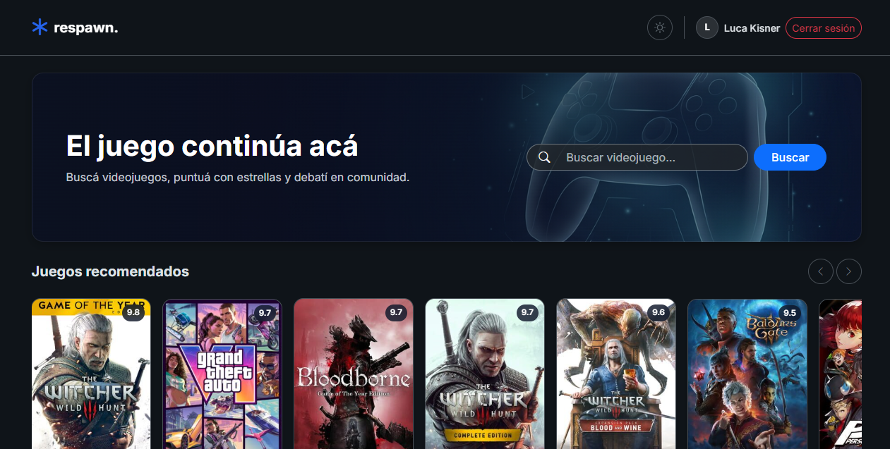
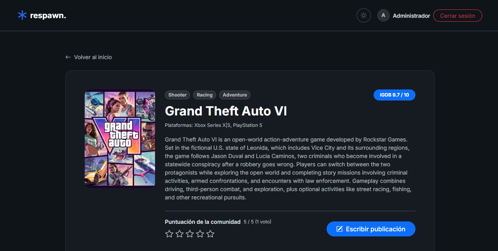
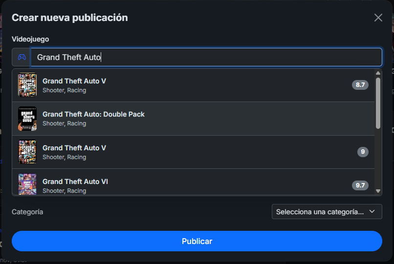
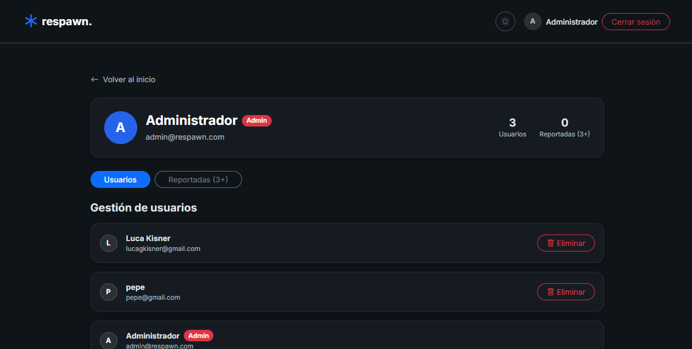

# Guía de Uso — Respawn

**Nombre de la aplicación:** Respawn  
**Acceso a la aplicación:** Ejecución local en `http://localhost:3000`  
**Versión:** 1.0.0  
**Cátedra:** Proyecto de Desarrollo de Aplicaciones Web (PDAW 2026) — DCIC — Universidad Nacional del Sur  
**Equipo:** Grupo 06  

---

## 1. ¿Para quién es?

Respawn es una plataforma web pensada para jugadores que quieren buscar información de videojuegos, puntuar títulos con estrellas y debatir en foros organizados por juego.

### Perfiles de usuario
- **Visitante:** Puede explorar el carrusel de **Juegos recomendados**, buscar videojuegos, consultar su ficha en `juego.html`, ver puntajes de la comunidad, leer publicaciones y comentarios, y filtrar el foro por categoría.
- **Usuario registrado:** Además puede crear publicaciones con selector dinámico de juegos, votar publicaciones con flechas (`↑` / `↓`), puntuar juegos de 1 a 5 estrellas (y borrar su puntuación), comentar o responder en hilos, editar o eliminar su propio contenido desde el menú de tres puntos (`⋯`), reportar publicaciones de otros usuarios y gestionar sus publicaciones y puntuaciones desde **Mi perfil** (`perfil.html`).
- **Administrador:** Cuenta con acceso al panel de administración en **Mi perfil** con dos pestañas (**Usuarios** para listar/eliminar cuentas y **Reportadas (3+)** para moderar publicaciones con 3 o más reportes). Puede eliminar cualquier publicación desde el inicio, la ficha del juego o el panel admin, pero no puede editar ni reportar publicaciones.

---

## 2. Primeros pasos

1. **Iniciar el servidor:** Ejecutar `npm install` y luego `npm run dev` (o `npm start`), con el archivo `.env` configurado a partir de `.env.example`.
2. **Ingresar desde el navegador:** Abrir `http://localhost:3000`.
3. **Crear cuenta o iniciar sesión:**
   - Presionar **Iniciar sesión** en la barra superior.
   - Para registrarse, completar nombre, correo válido y una contraseña de **8 a 20 caracteres** que incluya al menos **una mayúscula, un número y un carácter especial** (el formulario indica en tiempo real qué requisitos faltan).
   - Para ingresar como administrador inicial de prueba: `admin@respawn.com` / `Admin1234!`.

---

## 3. Tareas principales

### Explorar y buscar videojuegos
1. En el banner principal (*"El juego continúa acá"*), escribir el nombre del juego en **Buscar videojuego...** o recorrer el carrusel horizontal de **Juegos recomendados** con las flechas `<` y `>`.
2. Hacer clic en cualquier tarjeta de juego (o en el Top 5 de **Juegos mejor valorados**) para abrir su ficha dedicada (`juego.html`).

### Puntuar un videojuego y ver sus reseñas
1. Dentro de la ficha del juego se muestran la portada, géneros, plataformas, puntaje de IGDB y descripción.
2. Tocar de 1 a 5 estrellas para guardar o actualizar la calificación comunitaria; si ya puntuaste el juego, aparece el ícono de eliminar al lado de las estrellas para borrar tu voto.
3. Debajo de la ficha se listan todas las publicaciones y reseñas del juego con su contenido completo y sus comentarios inline.

### Crear publicaciones, filtrar y votar
1. Presionar **Nueva publicación** en el foro principal (o **Escribir publicación** dentro de un juego).
2. En el modal, buscar el **Videojuego** en el desplegable dinámico con portadas, completar el **Título**, el **Contenido** y elegir la **Categoría** (`Informativa`, `Review o reseña`, `Crítica`, `Bug o problema técnico` o `Descubrimiento o secreto`).
3. En el inicio se puede filtrar por categoría, ordenar por **Más recientes** o **Más votados** y votar con las flechas `↑` / `↓`.

### Comentar, editar, eliminar y reportar
1. Al hacer clic en el título de una publicación en el inicio, se abre la ficha del juego enfocando esa publicación con sus comentarios.
2. Escribir un comentario nuevo o usar **Responder** sobre uno existente para continuar el hilo.
3. Desde el menú de tres puntos (`⋯`) de cada publicación:
   - El **autor** puede **Editar** o **Eliminar** (con confirmación mediante toast).
   - Otros usuarios registrados pueden **Reportar** indicando un motivo (al llegar a 3 reportes aparece la etiqueta **En verificación**).
   - El **administrador** ve únicamente la opción **Eliminar**.

### Mi perfil y Panel de Administrador (`perfil.html`)
1. Al iniciar sesión, hacer clic en tu avatar o nombre arriba a la derecha para abrir **Mi perfil**.
2. **Usuario común:** alterna entre la pestaña **Publicaciones** (con filtro por categoría) y **Puntuaciones** (donde figuran las estrellas asignadas a cada juego con opción de eliminarlas).
3. **Administrador:** alterna entre la pestaña **Usuarios** (listado de cuentas registradas con opción de eliminar) y **Reportadas (3+)** (publicaciones marcadas para revisión con acceso directo y botón de eliminación).

---

## 4. Preguntas frecuentes

- **¿Qué ocurre si no hay conexión con IGDB o faltan credenciales de Twitch?** La aplicación utiliza un catálogo de respaldo para seguir funcionando sin errores.
- **¿Se pierden las cuentas, puntuaciones o publicaciones al reiniciar el servidor?** No, toda la información y las sesiones activas se guardan en `data/datos.json`.
